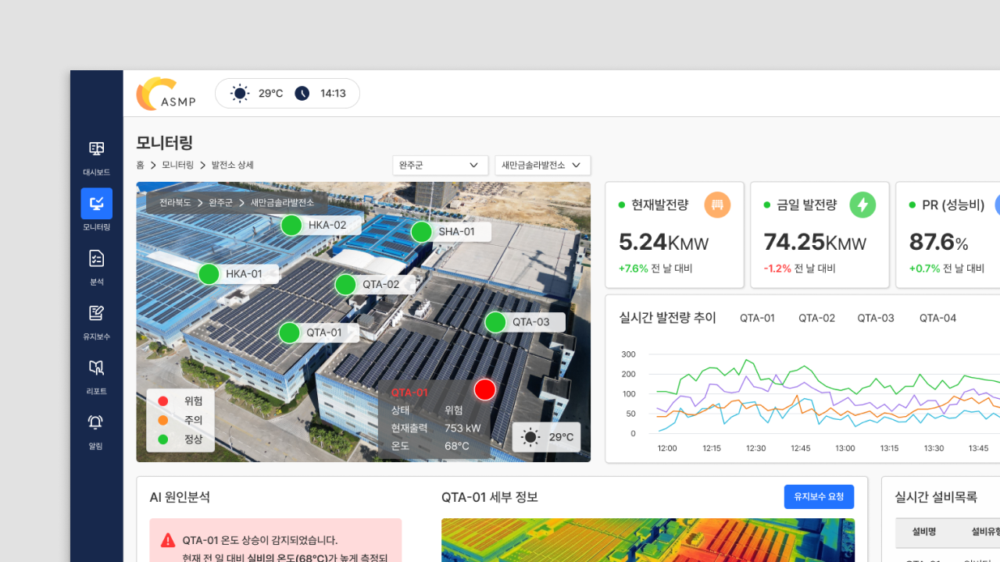

# 이수진 | UI/UX 포트폴리오

> Making complex workflows easier to navigate.

복잡한 정보와 업무 흐름을 사용자 관점에서 정리하는 UI/UX 디자이너 이수진의 포트폴리오입니다. B2B SaaS, 대시보드와 데이터 시각화, 관리자 도구, 서비스 UI, 그래픽 디자인 작업을 소개합니다.



## 사이트 구성

| 페이지 | 내용 |
| --- | --- |
| `index.html` | 소개, 전문 분야, 대표 작업 |
| `work.html` | 전체 작업 목록과 UI/UX·Graphic 필터 |
| `contact.html` | 경력, 참여 프로젝트, 교육·활동, 연락처 |
| `project/*.html` | 작업별 목표, 디자인 과정과 결과물 |

작업 목록에는 **20개의 상세 페이지**가 있습니다. 각 페이지에서 프로젝트의 배경과 역할을 살펴보고, 주요 이미지를 확대해 볼 수 있습니다. 레이아웃은 화면 크기에 맞게 조정됩니다.

## 대표 작업

| 작업 | 소개 |
| --- | --- |
| [AI 사이버보안 플랫폼](project/Cybersecurity.html) | 분산된 보안 정보를 통합하고 사건 조사부터 대응까지 연결한 인터페이스 |
| [AI 기반 업무 관리 엔터프라이즈](project/Workspac.html) | 프로젝트와 업무 흐름을 하나로 연결한 엔터프라이즈 서비스 |
| [KT 기업무선 관제플랫폼](project/KT.html) | 실시간 데이터 수집과 분석을 활용한 기업용 관제 화면 |
| [AI 기반 태양광 DX 플랫폼](project/Solar.html) | 발전 설비의 상태와 운영 데이터를 살펴보는 대시보드 |
| [기부 어플리케이션](project/Donation.html) | 기부 이후의 사용 현황과 진행 과정을 확인하는 모바일 서비스 |
| [아이투엘 브랜드 리브랜딩](project/i2L.html) | 브랜드 아이덴티티와 그래픽 결과물 |

전체 작업은 [`work.html`](work.html)에서 확인할 수 있습니다.

## 실행 방법

이 저장소는 **HTML, CSS, JavaScript로 만든 정적 웹사이트**입니다. 별도의 패키지 설치나 빌드 과정 없이 저장소 파일을 내려받아 루트의 `index.html`을 브라우저에서 열 수 있습니다.

로컬 웹 서버에서 확인하려면 프로젝트 루트에서 다음 명령을 실행한 뒤 `http://localhost:8000`에 접속하세요. Python 3이 설치된 환경에서 사용할 수 있습니다.

```bash
python3 -m http.server 8000
```

## 폴더 구조

```text
.
├── index.html             # 홈
├── work.html              # 작업 목록
├── contact.html           # 소개 및 연락처
├── style.css              # 홈 스타일
├── work_style.css         # 작업 목록 스타일
├── contact_style.css      # 연락처 스타일
├── images/                # 홈·목록에서 사용하는 이미지
└── project/
    ├── *.html             # 작업 상세 페이지 20개
    ├── project_style.css  # 상세 페이지 공통 스타일
    └── image/             # 작업 상세 이미지
```

## 연락처

- [Behance](https://www.behance.net/sulee07)
- [LinkedIn](https://www.linkedin.com/in/sulee07/)
- [이메일](mailto:sj.0107010@gmail.com)

© 2026 Lee Sujin. All rights reserved.
